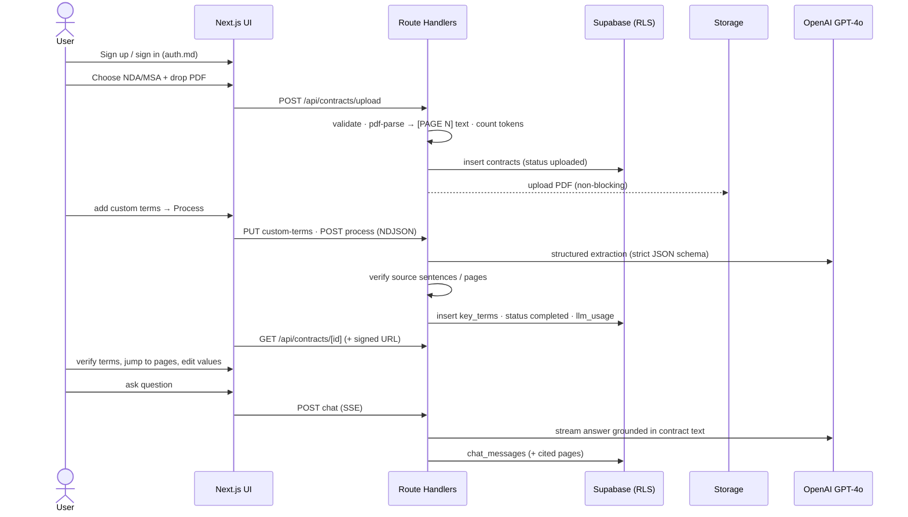

# ContractIQ — Implementation Specifications (Stage 2)

**Inputs:** `docs/ContractIQ_PRD.md` · `docs/engineering/engineering-doc.md` · `docs/engineering/implementation-specs.md` · `docs/design.md`
**App project:** `contractiq/` (Next.js 14 App Router, root `app/` layout) · **Date:** 2026-10-25

Each file below is self-contained: a developer can build its feature from that file alone. It lists the exact files, DB objects, API contracts, frontend components and state, edge cases, **acceptance criteria** (IDs `AC-…`) and tests. If any doc disagrees with `supabase-schema.sql` on database details, the SQL wins.

## 1. Spec index

| # | Spec | Feature / concern | Stories & FRs | Release |
|---|---|---|---|---|
| — | [`contractiq/supabase/database.sql`](../../contractiq/supabase/database.sql) (= [`supabase-schema.sql`](./supabase-schema.sql)) | Paste-and-run DB, transactional and self-checking: enums, 9 tables, view, triggers, RPCs, RLS, explicit grants, storage bucket + policies | FR-13, FR-14 | v0.1 |
| — | [`database.md`](./database.md) | Schema reference, state machine, RPC contracts, RLS matrix | FR-13, FR-14 | v0.1 |
| S1 | [`foundation-and-conventions.md`](./foundation-and-conventions.md) | Dependencies (verified versions), config, env, clients, API/error/stream conventions | — | v0.1 |
| S1 | [`design-system-ui.md`](./design-system-ui.md) | Tailwind tokens from `docs/design.md`, font, primitives, status colours | PRD §5 usability | v0.1 |
| S2 | [`landing-page.md`](./landing-page.md) | Marketing page | Flow 1 | v0.1 |
| S3 | [`auth.md`](./auth.md) | Sign up / in / out, callback, middleware | US-001, FR-01 | v0.1 |
| S4 | [`upload-and-text-extraction.md`](./upload-and-text-extraction.md) | Upload, validation, `[PAGE N]` text extraction, token count, storage | US-002, FR-02, FR-03 | v0.2 |
| S5 | [`custom-terms.md`](./custom-terms.md) | Pre-processing preview, ≤ 5 custom terms | US-005, FR-05 | v0.3 |
| S6 | [`key-term-extraction.md`](./key-term-extraction.md) | GPT-4o structured extraction, prompts, validation, NDJSON progress | US-002/3/4/5, FR-04, FR-11 | v0.2–0.3 |
| S7 | [`results-page.md`](./results-page.md) | Key-terms panel, confidence, ⚠, Why?, disclaimer | US-003, US-004, FR-04, FR-07, FR-11 | v0.2–0.3 |
| S8 | [`contract-viewer.md`](./contract-viewer.md) | PDF.js viewer + text fallback, page jump, highlight | US-006, FR-06, FR-07 | v0.3 |
| S9 | [`inline-editing.md`](./inline-editing.md) | Edit values, original preserved | US-009 | v0.4 |
| S10 | [`contract-chat.md`](./contract-chat.md) | Grounded streaming chat, citations, persistent history | US-007, US-012, FR-08, FR-09 | v0.4 |
| S11 | [`dashboard.md`](./dashboard.md) | Stats, recent, sortable history, empty state | US-008, FR-10 | v0.1/v0.4 |
| S12 | [`feedback.md`](./feedback.md) | Thumbs up/down + comment | US-010, FR-12 | v1.0 |
| S13 | [`data-retention-and-deletion.md`](./data-retention-and-deletion.md) | Delete cascade, 90-day PDF purge job | PRD §5 GDPR | v1.0 |
| S14 | [`llm-telemetry-and-alerts.md`](./llm-telemetry-and-alerts.md) | Rate limits, cost logging, Slack alerts | PRD §3/§5 | v1.0 |
| S15 | [`onboarding-and-accessibility.md`](./onboarding-and-accessibility.md) | Tour, WCAG 2.1 AA, mobile notice, performance gate | PRD §5, v1.0 | v1.0 |
| — | [`security.md`](./security.md) | Security controls baseline (expanded in Stage 7) | PRD §5, §3 risks | all |
| — | [`testing.md`](./testing.md) | Unit / integration / E2E / LLM eval plan, CI | PRD §10–11 | Stage 4–5 |
| — | [`deployment.md`](./deployment.md) | Local lab setup, Netlify, ops runbook | PRD §6, §11 | Stage 3/6 |
| — | [`../../contractiq/.env.example`](../../contractiq/.env.example) | Every environment variable, grouped by service | — | — |

Out of MVP scope (spec'd later): US-011 export (CSV/PDF), batch upload, analytics, OCR, comparison, teams, billing (engineering-doc §2.3).

## 2. Build order (Stage 4)
```
1 foundation-and-conventions + design-system-ui   (deps, config, primitives, env, clients)
2 supabase-schema.sql applied → db:types
3 auth → landing-page → dashboard (shell + empty state)
4 upload-and-text-extraction → key-term-extraction → results-page
5 custom-terms → contract-viewer
6 inline-editing → contract-chat → dashboard (full history)
7 feedback → data-retention-and-deletion → llm-telemetry-and-alerts → onboarding-and-accessibility
```
Per CLAUDE.md, each feature is confirmed with the user before coding, and `/design-system` is applied to all UI.

## 3. End-to-end workflow (how the specs connect)


## 4. Requirement coverage
| Requirement | Spec(s) / acceptance criteria |
|---|---|
| US-001 / FR-01 | auth.md AC-AUTH-01…09 |
| US-002 / FR-02 / FR-03 | upload AC-UP-01…08, extraction AC-EX-01, AC-EX-10 |
| US-003 / FR-07 | results AC-RES-04, viewer AC-VW-02 |
| US-004 / FR-04 / FR-11 | results AC-RES-01…03, extraction AC-EX-01…03 |
| US-005 / FR-05 | custom-terms AC-CT-01…06 |
| US-006 / FR-06 | viewer AC-VW-01…07 |
| US-007 / FR-08 | chat AC-CH-01…03, AC-CH-10 |
| US-008 / FR-10 | dashboard AC-DB-UI-01…08 |
| US-009 | inline-editing AC-ED-01…07 |
| US-010 / FR-12 | feedback AC-FB-01…05 |
| US-012 / FR-09 | chat AC-CH-04…06 |
| FR-13 | database AC-DB-01…09, security AC-SEC-01, testing `rls.int.test.ts` |
| FR-14 | `supabase-schema.sql`, database AC-DB-01/02 |
| Performance constraints | onboarding-and-accessibility §7, AC-PERF-01 |
| Cost ≤ $0.25 | telemetry §4–6, extraction AC-EX-11 |
| Retention / GDPR | data-retention AC-RET-01…05 |
| Hallucination guardrails (PRD §9) | extraction §4–6, results §6.7, chat §3–5, testing §6 |
| WCAG 2.1 AA | onboarding-and-accessibility AC-A11Y-01…03, design-system AC-DS-03 |

## 5. Decisions made in Stage 2 (refinements of the engineering plan)
| Topic | Engineering plan | Spec decision | Why |
|---|---|---|---|
| PDF retention | `pg_cron` + SQL `DELETE FROM storage.objects` | Scheduled job using the Storage API (service role) | Supabase blocks direct deletes on storage tables; SQL wouldn't remove files |
| OpenAI call | `chat.completions.parse` | `chat.completions.create` + `zodResponseFormat` + own zod validation | Works across SDK versions; we re-validate anyway |
| Strict schema | One zod schema | Wire schema (no length limits) + app schema (limits) | Strict mode supports only part of JSON Schema |
| Next.js | `14.2.5` (scaffold) | `~14.2.35` + mitigations; **upgrade decision before Stage 6** | 14.2.5 has a critical middleware bypass. All of Next 14 is EOL with open critical advisories, fixed only in 15.5.x/16.x |
| SDK versions | Approximate | Verified on npm (2026-10-25): `openai@7` (Node ≥ 22), `@supabase/ssr@0.12`, `react-pdf@9` (v10+ needs React 19) | Avoid install-time breakage |
| Warning badge text | Yellow 800 | Yellow 900 | Yellow 800 on Yellow 50 is 4.10:1, below WCAG AA |
| CSRF | Not specified | Origin check on mutating routes | Defence in depth with cookie auth |
| Privileges | RLS only | RLS + column grants (`analyses_count`, `confidence_score` not client-writable) | Prevents tampering with metrics |

## 6. Open items for the user
1. **Run `supabase-schema.sql`** in the Supabase SQL Editor. The project currently has no tables or `contracts` bucket. (`.env.local` now has working Supabase anon + service-role keys and a working OpenAI key.)
2. **Next.js 14 end-of-life**: approve an upgrade to 15.5.x/16.x, or accept the residual risk, before Stage 6.
3. **Supabase Auth settings** for the lab: Site URL `http://localhost:3000`, redirect `…/auth/callback`, "Confirm email" off (auth.md §2).
4. **Netlify function timeout** must be raised to 26 s before deploying (deployment.md §2).
