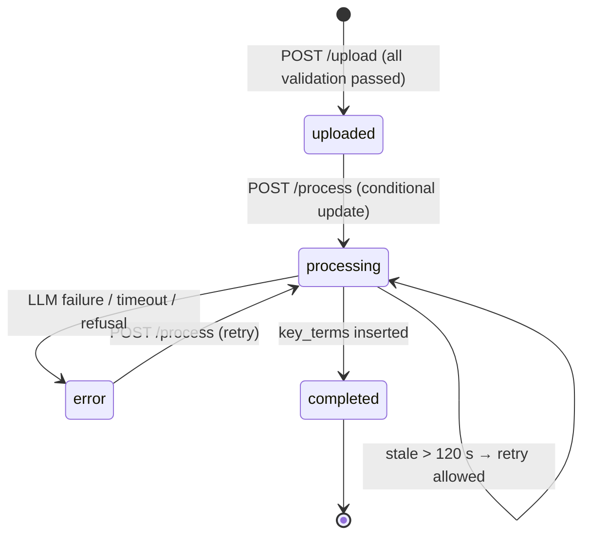
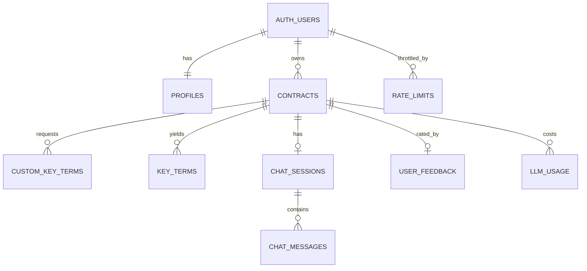

# Spec — Database (Supabase Postgres)

**Source:** engineering-doc §7 · **Runnable SQL:** [`contractiq/supabase/database.sql`](../../contractiq/supabase/database.sql) (canonical; [`supabase-schema.sql`](./supabase-schema.sql) is an identical copy, enforced by a unit test) · **Requirements:** FR-13, FR-14

This spec explains every object in `supabase-schema.sql` and how the app uses it. If this document and the SQL ever disagree, the SQL wins.

---

## 1. How to apply

1. Open Supabase → **SQL Editor** → New query.
2. Paste the whole of `contractiq/supabase/database.sql` and click **Run**. It runs as one transaction and ends with a self-check. Expected result: "Success. No rows returned", with the notice `ContractIQ database self-check passed.` If any check fails, the error lists every problem and nothing is applied.
3. Run the verification queries at the bottom of the file:
   - all 9 public tables show `rowsecurity = true`
   - the `contracts` bucket exists with `public = false`
4. Generate TypeScript types into the app with `npx supabase gen types typescript --project-id lrllzmcjotybsaempjip > contractiq/types/database.types.ts`. Run `npx supabase login` once first.
5. The script is idempotent: re-running it after edits is safe and does not drop data.

No extensions are required. `gen_random_uuid()` is built into Postgres 13+. The design does not use `pg_cron`; PDF retention runs as a scheduled job instead (see `data-retention-and-deletion.md`).

---

## 2. Enums

| Enum | Values | Used by |
|---|---|---|
| `contract_type` | `nda`, `msa` | `contracts.contract_type` (the user's selection) |
| `detected_contract_type` | `nda`, `msa`, `other` | `contracts.detected_type` (the model's opinion) |
| `contract_status` | `uploaded`, `processing`, `completed`, `error` | `contracts.status` |
| `chat_role` | `user`, `assistant` | `chat_messages.role` |
| `feedback_rating` | `up`, `down` | `user_feedback.rating` |
| `llm_operation` | `extraction`, `chat` | `llm_usage.operation` |

### Contract status state machine



---

## 3. Tables

Common conventions:
- `uuid` primary keys use `gen_random_uuid()`. Timestamps are `timestamptz`.
- Every user-owned table has `user_id → auth.users(id) ON DELETE CASCADE`.
- Child tables cascade from `contracts`, so one delete removes everything (S13).

### 3.1 `profiles`
| Column | Type | Null | Default | Constraint / note |
|---|---|---|---|---|
| `id` | uuid | no | — | PK, FK → auth.users |
| `email` | text | no | — | copied at signup |
| `full_name` | text | yes | — | ≤ 120 chars |
| `analyses_count` | integer | no | 0 | ≥ 0; incremented by `increment_analyses_count()` only |
| `onboarding_completed_at` | timestamptz | yes | — | set by the onboarding tour (S15) |
| `created_at` / `updated_at` | timestamptz | no | now() | `updated_at` trigger |

Rows are created by the `on_auth_user_created` trigger. Clients can update only `full_name` and `onboarding_completed_at` (column grant).

### 3.2 `contracts`
| Column | Type | Null | Default | Constraint / note |
|---|---|---|---|---|
| `id` | uuid | no | gen_random_uuid() | PK; the app supplies it so the storage path can be built first |
| `user_id` | uuid | no | — | FK |
| `title` | text | no | — | 1–200 chars; defaults to the filename without `.pdf` |
| `contract_type` | contract_type | no | — | |
| `detected_type` | detected_contract_type | yes | — | set by extraction |
| `status` | contract_status | no | `uploaded` | |
| `original_filename` | text | no | — | 1–255 chars |
| `file_path` | text | yes | — | `{user_id}/{contract_id}/{slug}.pdf`. NULL = storage failed or the file was purged |
| `file_size_bytes` | integer | no | — | 1–10,485,760 |
| `page_count` | smallint | no | — | 1–20 |
| `word_count` | integer | no | — | ≥ 100 |
| `token_count` | integer | no | — | 1–15,000 (GPT-4o `o200k_base` count) |
| `contract_text` | text | no | — | full text with `[PAGE N]` markers |
| `prompt_version` / `model` | text | yes | — | e.g. `extract-v1.0`, `gpt-4o` |
| `processing_ms` | integer | yes | — | ≥ 0 |
| `error_code` / `error_message` | text | yes | — | last failure |
| `processed_at` | timestamptz | yes | — | |
| `review_completed_at` | timestamptz | yes | — | North Star metric |
| `last_accessed_at` | timestamptz | no | now() | drives 90-day PDF retention |
| `created_at` / `updated_at` | timestamptz | no | now() | |

Indexes:
- `idx_contracts_user_created (user_id, created_at desc)`
- `idx_contracts_user_type (user_id, contract_type)`
- `idx_contracts_user_title (user_id, lower(title))`
- `idx_contracts_retention (last_accessed_at) WHERE file_path IS NOT NULL`

### 3.3 `custom_key_terms`
| Column | Type | Constraint |
|---|---|---|
| `id` | uuid | PK |
| `contract_id` | uuid | FK → contracts, cascade |
| `user_id` | uuid | FK |
| `term_name` | text | 2–80 chars |
| `is_manual` | boolean | default true (PRD flag) |
| `created_at` | timestamptz | |

The unique index `(contract_id, lower(term_name))` prevents case-insensitive duplicates. The trigger `trg_custom_key_terms_limit` caps a contract at 5 terms with error `custom_term_limit_exceeded` (`P0001`).

### 3.4 `key_terms`
| Column | Type | Constraint / note |
|---|---|---|
| `id` | uuid | PK |
| `contract_id`, `user_id` | uuid | FKs |
| `term_key` | text | slug; `custom_<slug>` for custom terms; unique per contract |
| `term_name` | text | display label |
| `value` | text | ≤ 1000; NULL = "Not found in document" |
| `original_value` | text | AI value captured on the first edit |
| `page_number` | smallint | NULL or 1–20 |
| `confidence_score` | smallint | 0–100 |
| `source_sentence` | text | ≤ 1000 |
| `source_verified` | boolean | sentence found in `contract_text` |
| `is_custom`, `is_edited` | boolean | |
| `edited_at` | timestamptz | |
| `sort_order` | smallint | position in the target list |
| `created_at` / `updated_at` | timestamptz | |

Clients may only update `value`, `original_value`, `is_edited` and `edited_at` (column grant). In practice they use `edit_key_term()`.

### 3.5 `chat_sessions`
`id`, `contract_id` (unique: one session per contract), `user_id`, `message_count` (maintained by trigger), `created_at`, `updated_at`.

### 3.6 `chat_messages`
| Column | Type | Constraint |
|---|---|---|
| `id` | uuid | PK |
| `session_id` | uuid | FK → chat_sessions, cascade |
| `user_id` | uuid | FK |
| `role` | chat_role | |
| `content` | text | 1–8000 chars |
| `cited_pages` | smallint[] | default `{}` |
| `query_class` | text | `contract` / `history` / `both` (user rows) |
| `latency_ms` | integer | assistant rows |
| `created_at` | timestamptz | |

Index `(session_id, created_at)` serves the history query.

### 3.7 `user_feedback`
`id`, `user_id`, `contract_id`, `rating`, `comment` (≤ 1000), `created_at`, `updated_at`. Unique `(user_id, contract_id)`: one rating per user per contract, updated by upsert.

### 3.8 `llm_usage`
`id`, `user_id`, `contract_id` (SET NULL on delete), `operation`, `model`, `input_tokens`, `output_tokens`, `cached_input_tokens`, `cost_usd numeric(10,6)`, `latency_ms`, `attempts` (1–5), `success`, `finish_reason`, `created_at`.

Written **only** with the service-role key. Users can read their own rows. It never stores contract text or prompts.

### 3.9 `rate_limits`
PK `(user_id, bucket, window_start)`, plus `count`. `bucket` must be one of `upload`, `process` or `chat`. Clients have no privileges; access goes through `check_rate_limit()` only.

### 3.10 View `term_corrections`
Edited key terms joined to the contract type, created with `security_invoker = true` so RLS applies. Feeds the correction-rate metric and weekly prompt review.

### ERD



---

## 4. Functions (RPC)

The app calls these with the user-scoped client, `supabase.rpc(name, args)`.

| Function | Security | Args → returns | Purpose / errors |
|---|---|---|---|
| `replace_custom_terms` | invoker | `(p_contract_id uuid, p_terms text[])` → setof custom_key_terms | Atomic delete + insert. Raises `custom_term_limit_exceeded` (P0001) if more than 5, and `contract_not_found` (P0002) |
| `edit_key_term` | invoker | `(p_id uuid, p_value text)` → key_terms | Keeps the first AI value in `original_value`. No-op if the value is unchanged. Raises `key_term_not_found` (P0002) |
| `get_or_create_chat_session` | invoker | `(p_contract_id uuid)` → chat_sessions | Race-safe. Raises `contract_not_found` (P0002) |
| `get_dashboard_stats` | invoker | `()` → `(total, nda, msa)` bigint | Counters for the current user |
| `increment_analyses_count` | definer | `()` → void | +1 on own profile after a successful extraction |
| `check_rate_limit` | definer | `(p_bucket text, p_max int, p_window_seconds int)` → `(allowed bool, retry_after_seconds int)` | Fixed window. Also deletes the caller's windows older than 1 day |

Trigger functions: `set_updated_at`, `handle_new_user` (definer), `enforce_custom_term_limit`, `bump_chat_session` (definer). All functions set `search_path = ''` and use schema-qualified names.

**Mapping Postgres errors in the app** (`lib/api/errors.ts → fromPostgrestError`):

| Postgres | App error |
|---|---|
| `P0001` + `custom_term_limit_exceeded` | 400 `VALIDATION_ERROR` "Up to 5 custom terms" |
| `P0002` | 404 `NOT_FOUND` |
| `23505` (unique violation) | 400 `VALIDATION_ERROR` "Duplicate term" |
| `23514` (check violation) | 400 `VALIDATION_ERROR` |
| `42501` | 401 `UNAUTHENTICATED` |
| anything else | 500 `INTERNAL_ERROR` |

---

## 5. Row Level Security

RLS is enabled on all 9 tables. Policies use `(select auth.uid())`, which Supabase recommends for performance.

| Table | select | insert | update | delete |
|---|---|---|---|---|
| profiles | own | — (trigger) | own (2 columns) | — |
| contracts | own | own | own | own |
| custom_key_terms | own | own + own contract | — | own |
| key_terms | own | own + own contract | own (4 columns) | own |
| chat_sessions | own | own + own contract | own | own |
| chat_messages | own | own + own session | — | own |
| user_feedback | own | own + own contract | own | own |
| llm_usage | own | service role only | — | — |
| rate_limits | — | via function | via function | — |

`anon` has no table privileges at all.

**Explicit grants (required):** newer Supabase projects do not auto-grant table privileges to `anon`/`authenticated`/`service_role`. `supabase-schema.sql` §10 revokes everything from the client roles and then grants exactly what the app needs: per-table verbs for `authenticated` (with column-limited `UPDATE` on `profiles` and `key_terms`) and full access for `service_role`. A missing grant shows up as `42501 permission denied for table …`.

**Storage (`contracts` bucket):** private, 10 MB file limit, `application/pdf` only. Three policies on `storage.objects` (INSERT, SELECT, DELETE) for `authenticated`, each with `bucket_id = 'contracts' AND (storage.foldername(name))[1] = auth.uid()::text`. There is no UPDATE policy, so uploads use `upsert: false`.

---

## 6. Generated types

`types/database.types.ts` is generated, never hand-edited. Regenerate it after any schema change. Domain types in `types/domain.ts` derive from it:

```ts
import type { Database } from './database.types'
export type ContractRow  = Database['public']['Tables']['contracts']['Row']
export type KeyTermRow   = Database['public']['Tables']['key_terms']['Row']
export type ContractType = Database['public']['Enums']['contract_type']
export type ContractStatus = Database['public']['Enums']['contract_status']
```

---

## 7. Acceptance criteria

- **AC-DB-01:** Running `supabase-schema.sql` on a fresh Supabase project completes without errors, and running it a second time also succeeds.
- **AC-DB-02:** After running, all 9 public tables report `rowsecurity = true` and the `contracts` bucket exists with `public = false`.
- **AC-DB-03:** Signing up a new user creates exactly one `profiles` row.
- **AC-DB-04:** Using user B's session:
  - every `select` on user A's rows returns 0 rows
  - every `update`/`delete` affects 0 rows
  - an `insert` with `user_id = A` is rejected
  - downloading `A/<id>/file.pdf` from storage fails
- **AC-DB-05:** Inserting a 6th custom term for one contract fails with `custom_term_limit_exceeded`.
- **AC-DB-06:** `edit_key_term` called twice keeps the first AI value in `original_value`.
- **AC-DB-07:** `check_rate_limit('process', 10, 3600)` returns `allowed = false` on the 11th call within the hour, with `retry_after_seconds > 0`.
- **AC-DB-08:** Deleting a contract removes its key terms, custom terms, chat session, messages and feedback, and sets `llm_usage.contract_id` to NULL.
- **AC-DB-09:** An authenticated client cannot update `profiles.analyses_count` or `key_terms.confidence_score` (permission denied).
